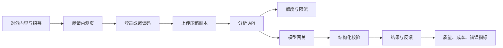

# 对外邀请内测准备与代码交接规划

日期：2026-09-23  
状态：待用户审阅  
目标阶段：从本地 MVP 进入 5–10 人邀请内测，再决定是否扩大公开访问

## 0. 这份文档解决什么问题

这不是“立刻把网址发出去”的发布清单，而是下一阶段的交接入口。下一位开发者、设计者或运营人员接手时，应先读本文件，再读当前 MVP 规格、隐私 ADR 和模型评测结果。

本阶段的产品目标是验证三件事：

1. 摄影爱好者是否愿意上传自己的照片并认真阅读点评。
2. 点评是否足够具体、克制，能推动下一次拍摄或后期尝试。
3. 在可控的模型费用、等待时间和隐私边界内，服务能否稳定运行。

“公开发内容、招募体验者”和“开放一个任何人都能上传照片的服务”是两个不同的动作。本规划先支持前者，再用邀请制验证后者。

## 1. 当前状态：可以演示，尚未具备公开上传条件

### 已完成

- `apps/web` 是本地 Next.js 应用，包含首页、照片分析页、结果页、历史记录页和 `/api/analyze`。
- 上传后先生成分析副本，原图不覆盖；结果包含观察事实、摄影解释、主观判断、替代解读、建议、评分和图层标注。
- 模型返回经过 Zod/schema 规则、分数、坐标和裁切损失校验；格式错误时最多进行一次修复请求。
- 当前适配层可通过环境变量选择 DashScope/Qwen 或 DeepSeek Flash，默认仍保留 DashScope 兼容路径。
- DeepSeek 的快速路径默认关闭 thinking；当前模型选择不需要写进页面代码。
- 历史记录和人工反馈可以在当前浏览器中保存、查看和删除。
- 最近一轮本地验证基线：42 个测试通过，类型检查、Lint、生产构建和 `git diff --check` 通过。

### 目前缺少

- 没有公网服务器、域名、HTTPS、部署环境、监控和告警。
- 没有账户、邀请码、用量额度、频率限制、每日预算上限或一键停用分析接口。
- 没有服务端数据库和对象存储；历史记录仍属于当前浏览器，换设备或网址不会跟随。
- 没有服务端的原图/预览生命周期、删除任务和备份清理流程。
- 没有发布环境的密钥管理、灰度发布和回滚流程。
- 没有公开的隐私说明、服务协议、反馈/投诉入口和模型服务公示页。
- 没有完成真实移动端、竖图、全景图和弱网环境的浏览器验收。
- 现有 `qwen-adapter.ts`、`analyzeWithQwen`、部分测试名称和文档仍带有 Qwen 专属命名，结构上已经不符合多供应商状态。

因此，当前版本适合产品演示和小范围人工邀请；不适合直接把 `/analyze` 发给不受控的公开流量。

## 2. 先纠正一个模型认知

当前代码没有切换到 OpenAI GPT。实际支持的是：

- DashScope/Qwen：通过 `DASHSCOPE_API_KEY` 和兼容接口调用。
- DeepSeek Flash：通过 `DEEPSEEK_API_KEY`，请求模型名为 `deepseek-flash`。

“Qwen API JSON”是旧的结果页文案，不代表当前一定使用 Qwen。它已经改为“结构化分析 · 工作台规则已通过校验”，具体模型只保留在次级模型信息中。下一轮应继续把代码里的 Qwen 专属名称改为供应商无关名称：

```text
qwen-adapter.ts       → model-adapter.ts 或 model-gateway.ts
analyzeWithQwen()     → analyzePhoto()
Qwen workbench prompt  → model gateway contract
```

如果将来真的接 OpenAI GPT，需要新增独立供应商配置、数据位置和合规评估，不能把“DeepSeek Flash”简称成 GPT。

## 3. 下一阶段边界

### 本阶段要做

- 把本地工作台收口为可供 5–10 人使用的邀请内测版。
- 建立一个可控的服务端，保护 API Key、图片和模型额度。
- 清理内部调试文案，保留必要的模型透明度和隐私告知。
- 让等待过程更容易理解，让模型层减少无效输出和无效重试。
- 建立固定评测、真实用户反馈、成本和错误记录。
- 准备一套可以用于小红书、朋友圈、摄影群或个人主页的招募内容。

### 本阶段暂不做

- 不做开放注册、复杂会员体系、支付和社区关系链。
- 不做公开作品墙、默认公开照片、模型训练授权或生成式修图。
- 不做风格复制承诺；用户填写“模仿某位摄影师”只用于解释语境，不宣传成复制该摄影师。
- 不做多图批量分析、RAW 全量支持和大规模异步队列，除非内测数据证明它们是第一阻塞点。

## 4. 工作流总览



发布顺序：

1. 内部收口与命名。
2. 服务器基础设施和数据边界。
3. 5–10 人邀请内测。
4. 修复高频问题并扩展到 30–100 人封闭测试。
5. 再评估是否开放公开上传或付费。

## 5. 代码结构交接

### 5.1 模型层

当前 `qwen-adapter.ts` 同时承担配置、提示词、HTTP 请求、网络重试、JSON 提取、结构化归一化和计时日志。下一轮拆成以下边界：

```text
apps/web/src/server/model/
  config.ts                 供应商、模型、密钥和端点配置
  gateway.ts                统一 analyzePhoto() 入口
  prompt.ts                 摄影提示词与版本
  response-parser.ts        JSON 提取和截断处理
  response-normalizer.ts    schema、分数、坐标和裁切降级
  providers/
    openai-compatible.ts    DashScope、DeepSeek 等兼容接口
```

统一入口只接收内部 `AnalysisRequest`，只返回 `AnalysisResult` 或分类后的错误。页面不读取供应商原始响应。

每个供应商配置必须记录：供应商、模型名、版本或快照、数据位置、价格、是否支持视觉、是否支持 JSON 输出、thinking 设置和替换方案。

### 5.2 应用层

- 把 `/api/analyze` 改成“鉴权 → 配额 → 请求记录 → 图像处理 → 模型网关 → 结果保存”的应用服务，不让路由文件承担全部业务。
- 把本地 IndexedDB 的 `history-store` 抽象成 `HistoryRepository`，保留本地实现，同时为服务端实现预留接口。
- 把人工反馈分成用户反馈和内部评测反馈。CSV 导出只保留内部管理员使用，不展示给普通用户。
- 将 `experiments/ai-analysis-eval` 与正式应用的环境变量、日志和部署脚本分开；正式应用不应依赖评测台目录才能启动。
- 清理 `features/prototype` 对正式页面的命名依赖。公共图片样例可以保留，但应移动到明确的首页内容目录，并记录授权来源。

### 5.3 测试层

下一轮新增：

- 模型供应商切换和请求体回归测试。
- 402、401、429、超时、空响应、截断 JSON 的用户错误映射测试。
- 额度扣减只发生一次的幂等测试。
- 用户删除后照片、分析、反馈和派生文件都不可再访问的删除测试。
- 5 张固定照片的格式通过率、关键字段完整率、坐标安全率和延迟回归。
- Playwright 桌面/移动端流程：上传、等待、失败重试、结果阅读、历史、删除。

## 6. 模型层和等待体验优化

当前真实瓶颈主要在模型请求，不是按钮动画。目标不是制造假的进度，而是减少不必要的等待，并让等待中的每一秒都有清楚含义。

### 6.1 模型请求

1. 保持 DeepSeek Flash 快速路径关闭 thinking，只有用户明确需要深度解释时才打开。
2. 继续发送压缩副本；在固定评测集不掉质量的前提下，评估更短的长边和更低的 `max_tokens`。
3. 将模型输出分为“首轮正常请求”和“格式修复请求”。只有 JSON/schema 失败才修复；402、401、403、429、5xx 和超时应直接分类，不重复消耗额度。
4. 完善响应错误正文解析。用户看到“账户余额不足”“服务暂时拥堵”或“配置缺少 Key”等可执行提示，管理员日志保留状态码和 request id，不保存照片内容。
5. 对同一张压缩图、同一意图和同一模型做短期去重，避免用户重复点击或刷新造成重复扣费。
6. 记录 `prepare_ms`、`network_ms`、`parse_ms`、`total_ms`、输入字节、输出字符、重试次数和模型名，用 p50/p95 判断是否真的变快。
7. 评估流式响应前先完成结构化结果协议。若不能安全增量展示 JSON，就继续使用完整结果返回，避免半截点评被用户当成结论。

### 6.2 用户等待流程

- 选图时完成压缩，点击分析后不再做第二次重复压缩。
- 立即显示“正在读取画面”，同时保留照片、创作意图和取消/重试位置。
- 按真实阶段显示“读取画面 → 整理点评 → 校验结果”；不显示百分比进度。
- 10 秒、30 秒、60 秒分别给出不同提示：仍在等待、可能需要更久、可以重试；提示不夸大后台状态。
- 失败时保留用户已填写的创作意图和照片预览，点击重试只重新发请求，不要求重新选图。
- 在服务器支持任务状态后，再考虑用户离开页面后回来继续查看；目前不伪装成后台任务。

### 6.3 体验目标

内测阶段记录真实分布，不先承诺固定秒数。建议验收指标：

- 首屏到可点击上传的时间稳定。
- 分析请求成功率 ≥ 98%。
- 正常请求 p50、p95 延迟单独记录，格式修复比例 < 5%。
- 402/401/429 不触发自动重复扣费。
- 用户能在不刷新、不回到终端的情况下完成失败重试。

## 7. 服务器和部署准备

### 7.1 最小生产架构

```text
域名 + HTTPS
  └─ Next.js Node 服务
      ├─ 鉴权 / 邀请码 / 配额 / 限流
      ├─ 分析 API 与模型网关
      ├─ PostgreSQL：用户、邀请码、额度、分析元数据、反馈
      ├─ 私有对象存储：原件短期、预览长期、删除任务
      └─ 结构化日志、错误监控、成本告警
```

第一版不需要微服务。一个可回滚的 Node 应用、一个数据库和一个私有对象存储就够了。

### 7.2 必须准备的服务能力

- staging 和 production 两套环境，Key、数据库和对象存储完全分离。
- 密钥只放部署平台的 secret manager，不进 `.env` 提交、不出现在浏览器。
- 统一 request id；日志只记录用户匿名标识、阶段、状态码、延迟、模型和用量，不记录照片二进制、Base64、永久图片 URL 或完整 EXIF。
- 每个用户每日次数上限、全站每日预算上限、单 IP/账户限流，以及管理员停用模型开关。
- 401/402/429/5xx 分类告警；余额低于阈值时停止新任务或切换备用模型。
- 健康检查、错误监控、数据库备份、对象存储生命周期规则和回滚版本。
- 分析请求幂等键，避免刷新页面造成重复模型调用。

### 7.3 图片生命周期

建议使用两类对象：

- 原件：短期保存，只用于生成分析副本，自动过期。
- 分析预览：去除精确 GPS 等不必要元数据，按用户可见历史期限保存。

用户删除时同时删除数据库记录、原件、预览、反馈关联和可定位的派生文件。删除失败必须进入待处理队列并告警，不能只删除网页上的一张卡片。

### 7.4 地域、备案和模型服务

如果面向中国大陆公众提供网站服务，需要根据部署主体、域名、是否经营和模型服务类型核对备案、数据处理和模型公示要求。已上线的生成式 AI 应用或功能通常需要在显著位置或产品详情页公示所使用的已备案服务、模型名称及备案号；具体适用范围应让部署服务商和合规人员确认。[网信办模型备案公示说明](https://www.cac.gov.cn/2024-04/02/c_1713729983803145.htm)

《生成式人工智能服务管理暂行办法》要求保护输入信息和使用记录、提供删除等请求处理机制，并对具有舆论属性或社会动员能力的服务提出安全评估和算法备案要求。[管理办法](https://www.cac.gov.cn/2023-07/13/c_1690898327029107.htm)

中国大陆网站的域名访问服务还要按部署主体和服务类型核对 ICP/非经营性备案要求。[工信部备案管理办法](https://www.miit.gov.cn/gyhxxhb/jgsj/cyzcyfgs/bmgz/xxtxl/art/2024/art_84a0cfa0ebd049bbbe751dca9a008e56.html)

如果模型服务或存储发生境外传输，必须先完成数据位置、服务条款和个人信息出境评估，不能因为“测试”就默认把用户照片传到境外。

## 8. 对外 UI 收口清单

### 首页

- 暂定品牌名、核心一句话、上传按钮、隐私承诺。
- 删除开发版“本地版”字样，改成准确的“照片默认私密，分析只发送压缩副本”。
- 样例照片必须有授权说明，不把公共样例误解为用户作品。
- 增加“适合谁”和“不适合什么”的简短说明：帮助理解照片，不替用户创作，也不是权威审美裁决。

### 上传页

- 使用“上传照片 → 可选填写意图 → 获取点评”的三步文案。
- 把 JPEG/PNG/WebP 和大小限制放到上传控件附近，不在首屏堆实现细节。
- 隐私、第三方模型处理、保存期限和删除入口放进可展开说明与独立隐私页。
- 错误消息区分余额、网络、照片格式和服务繁忙，不直接展示堆栈或供应商原始文本。

### 结果页

- 保留模型名称和版本的透明度，但放进“分析信息”折叠区。
- 主标题改为一句具体结论，不把“快速索引”放成权威分数。
- 首屏优先展示主观判断、意图关系和一到三个下一步动作。
- 把“校验信息”、schema、Prompt 版本和内部评测字段移入管理员/调试视图。
- 用户反馈改成一问一答；内部评分和 CSV 导出只在管理员端出现。

### 历史页

- 明确当前是“本设备历史”还是“账户历史”。在有账户前不要暗示跨设备同步。
- 提供单条删除和“清空本设备历史”，并说明删除范围。
- 公网版本必须有服务端删除入口和删除结果反馈。

## 9. 预热与招募准备

### 内容定位

第一阶段内容只验证一个承诺：

> 上传一张照片，写下你想表达什么，得到有画面依据的摄影点评和下一次可尝试的动作。

不要使用“AI 判断好照片”“一秒出大师点评”“复刻森山大道”等容易误导或引起版权、审美权威误解的表述。

### 招募页最少信息

- 这是一个邀请制摄影分析内测。
- 适合街头、日常纪实、旅行和城市摄影爱好者。
- 每位体验者可使用多少次、单次大致等待范围和遇到问题的反馈方式。
- 照片是否发送给模型服务、保存多久、如何删除。
- 体验者需要完成什么：上传、阅读、评价准确性、说明是否愿意再次使用。
- 明确“不需要上传不愿意交给第三方模型处理的照片”。

### 招募后的观察指标

- 报名 → 首次上传转化率。
- 首次分析成功率和实际等待时间。
- 结果页阅读完成率。
- 是否查看图上证据、意图关系、建议或历史记录。
- 7 天/14 天内再次上传率。
- 用户认为最有帮助和最不可信的部分。
- 每次成功分析成本、失败成本和重复请求比例。
- 严重误判、隐私投诉、误删、模型余额告警次数。

## 10. 名称决策

当前“暗房”继续作为工作名没有问题，但公开投放前需要形成一页命名决策：

- 最终中文名与一句话定位。
- 是否需要英文名，以及英文名是否只是内部使用。
- 域名、社交账号和商标近似查询结果。
- 名称是否会让用户误解为修图工具、社交社区或摄影机构。
- 视觉语气：克制、证据化、尊重摄影表达。

品牌命名不应该阻塞内部评测；但在购买域名、做广告素材和收集公开报名时应先确定一个可对外使用的名字。

## 11. 阻断项与退出条件

### 进入 5–10 人邀请内测前

- [ ] 用户审阅并确认本规划和当前 MVP 规格。
- [ ] 供应商、模型名、数据位置和 Key 归属确定。
- [ ] 结果页无 Qwen API JSON 等错误内部文案。
- [ ] staging 服务可部署、可回滚，API Key 不进入浏览器。
- [ ] 邀请码、额度、限流和管理员停用开关通过测试。
- [ ] 402/401/429/超时/格式错误有用户可理解的提示。
- [ ] 固定评测集通过，且有延迟和成本基线。
- [ ] 隐私说明、删除流程和模型服务公示入口上线。
- [ ] 至少一次桌面和移动端真实图片验证。

### 进入 30–100 人封闭测试前

- [ ] 服务端历史、删除和反馈链路稳定。
- [ ] 单次分析成本和每日预算可监控。
- [ ] 主要错误能被定位到图片处理、模型、网络还是存储阶段。
- [ ] p50/p95 延迟达到可接受范围，格式修复比例稳定。
- [ ] 用户复用率和帮助度达到项目书目标，且没有阻断级隐私事件。

### 公开上传或付费前

- [ ] 备案、模型公示、隐私和服务协议完成适用性确认。
- [ ] 账户、额度、删除、申诉和滥用处理流程可持续运行。
- [ ] 明确公开照片、模型改进和生成式内容授权，并且默认关闭。
- [ ] 成本、退款或额度补偿策略明确。
- [ ] 品牌、域名、客服和故障公告渠道确定。

## 12. 推荐执行顺序

### 第一步：收口当前代码

1. 把所有 Qwen 专属 UI、测试标题和模块命名改成供应商无关名称。
2. 更新设计规格中已经过时的图片压缩参数；规格目前写的是最长边 2048px 和约 2.5MB，代码已经采用更小的分析副本，必须统一口径。
3. 隐藏内部 schema、Prompt、CSV 和开发工具文案。
4. 增加统一错误分类和等待体验测试。

### 第二步：搭建 staging 服务

1. 选择数据地域和部署主体。
2. 部署一个 Node 应用、PostgreSQL 和私有对象存储。
3. 接入 secrets、日志、监控、预算告警和回滚。
4. 完成邀请码、限流、额度和停用开关。

### 第三步：邀请内测

1. 先邀请 5–10 位目标用户。
2. 每人给固定次数，不公开永久链接。
3. 每周整理一次严重错误、等待体验、帮助度和成本。
4. 只修复影响信任、完成率和成本的高频问题。

### 第四步：决定是否扩大

当内测数据支持复用率、点评帮助度、稳定性和成本时，才进入 30–100 人封闭测试；否则继续留在邀请制，不急着投放。

## 13. 接手后的第一批任务

1. 阅读本文件、[本地 MVP 设计规格](../../specs/2026-08-24-local-mvp-design.md)、[隐私生命周期 ADR](../../decisions/0002-privacy-first-photo-lifecycle.md) 和[供应商抽象 ADR](../../decisions/0001-domestic-model-provider-abstraction.md)。
2. 确认模型供应商和数据地域；不要把“GPT”当作当前实现名称。
3. 完成 UI 文案和模型适配层的供应商无关重命名。
4. 为 staging 服务提交部署设计和数据字典，再开始写账户、邀请码和额度代码。

本规划的下一项可验收产物是：一份已选部署地域的 staging 架构图、一份隐私与数据字段表，以及一个能限制 5–10 个邀请码用户分析次数的测试环境。
